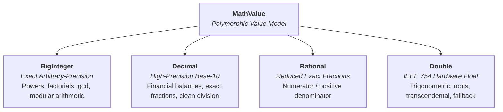
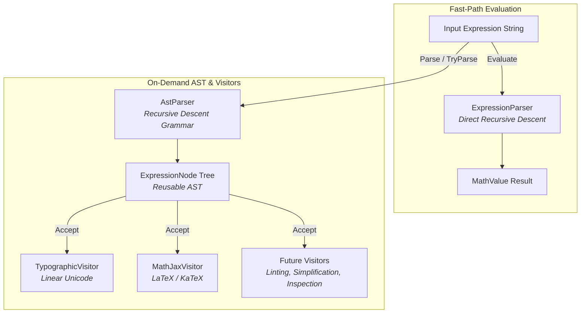

# Numerical Architecture & Type Model

Most mathematical expression evaluators rely exclusively on 64-bit IEEE 754 double-precision floating-point arithmetic (`double`). While double-precision arithmetic is fast and hardware-accelerated, it introduces noticeable limitations when evaluating everyday arithmetic:

1. **Binary Floating-Point Artifacts:** Fractions such as `0.1` and `0.3` cannot be represented with finite binary expansions. Standard engines evaluate `0.3 / 0.1` as `2.9999999999999996` rather than `3`. Financial subtraction like `3033554.11 - 3033359.71` yields `194.3999999999...` instead of `194.40`.
2. **Integer Precision Gaps:** Beyond $2^{53}$ ($\approx 9 \times 10^{15}$), consecutive integers cannot all be represented. For instance, every integer between $10^{16} - 5$ and $10^{16} + 50$ silently rounds to $10^{16}$. Larger integers like $2^{64}$ lose their least-significant bits entirely (`18446744073709600000` instead of `18446744073709551616`).

---

## The Hybrid Numerical Model

Numera stores Integer, Decimal, Rational, or Double in `MathValue`. Integer, Decimal, and Rational arithmetic preserves exact fractions within configured limits. Mixing with Double introduces an approximate boundary; exact arithmetic never silently downgrades after a limit violation.

> [!TIP]
> Use `MathValue.Exactness` (`Exact` or `Unverified`) to guide UI indicators and interpret calculation paths, not to infer exactness from storage. `1/3` is Exact despite a rounded display; `floor(pi)` remains Unverified despite a whole-number answer. The [exactness guide](exactness.md) explains these distinctions and the limits of what this metadata tells you.



### 1. BigInteger (Exact Integer Arithmetic)
- Backed by .NET's arbitrary-precision `System.Numerics.BigInteger`.
- Operates within a 16,384-bit safety ceiling ($\approx 4,932$ decimal digits).
- Exact operations include integer addition, subtraction, multiplication, integer powers, bitwise shifts, `factorial(n)`, combinatorics, `gcd`, `lcm`, and number-theoretic functions.
- Integer division produces Rational unless it divides evenly (such as `10^50 / 10^49`), in which case it remains Integer.
- Perfect integer squares evaluated via `sqrt` produce exact integers (e.g. `sqrt(144) == 12`).

### 2. Decimal (Base-10 Fixed/Floating Arithmetic)
- Backed by .NET's 128-bit `System.Decimal`.
- Provides 28–29 significant digits of precision with an exact base-10 exponent.
- Preserves exact decimal fractions and financial balances without binary rounding artifacts (`3033554.11 - 3033359.71 = 194.40`, `0.3 / 0.1 == 3`).
- Finite decimal literals are parsed exactly, including scientific notation. Exact arithmetic uses numerator/denominator values internally rather than rounding to Decimal capacity.
- A decimal point selects the Decimal domain, including integral literals such as `1.00`. Scientific literals with negative exponents also select Decimal when exactly representable; scientific integers without a decimal point stay Integer.
- Integer/Decimal arithmetic retains Decimal when exactly representable, including integral answers such as `0.5 + 0.5`. Decimal capacity failures retain the exact value as Rational or Integer, rather than rounding or silently using Double. Tiny terminating fractions and long coefficients outside Decimal capacity remain exact.

### 3. Rational (Reduced Fractions)
- Stores a GCD-reduced numerator and positive denominator, bounded by `CalculationLimits`.
- `FromFraction` / `FromRational` retain Rational whenever the reduced denominator is not one, even for terminating fractions such as `1/2`. A denominator of one normalizes to Integer.
- Arithmetic involving Rational stays in that domain, with integral results normalizing to Integer. Explicit Decimal input does not convert a Rational operand to Decimal.
- Preserves results such as `1/3`, `(1/3)*3`, and `1/3 + 0.5` without expression expansion or replay.
- Integer powers, including negative powers, use bounded exact fraction arithmetic. Size failures throw `CalculationLimitException`.
- `sqrt`, `cbrt`, `root`, and `nthroot` recognize perfect fraction roots for positive integer degrees by rooting both reduced components. Domain validation uses the original inputs before floating-point approximation.
- Standard deviation (`stdev` / `stddev`) applies these root rules to sample variance, preserving exact perfect roots.

### 4. Double (IEEE 754 64-Bit Floating-Point)
- Backed by hardware `System.Double`.
- Used for transcendental functions (`sin`, `cos`, `tan`, `ln`, `exp`), roots not recognized as exact, non-integer exponents, and arithmetic mixed with supplied Double values.
- Provides approximately 15–17 significant digits across magnitudes up to $\approx \pm 1.8 \times 10^{308}$.
- Overflows produce `double.PositiveInfinity` or `double.NegativeInfinity`; undefined domains return `NaN` or report structured diagnostics.
- Approximate roots retain the binary magnitude of exact inputs that would project to zero, subnormal values, or infinity before rooting. Only the final approximate root is subject to Double's output range.
- Negative finite bases with finite fractional power exponents report `UndefinedMathResult`. Power domain checks use the original values before Double conversion; nonfinite Double exponents follow native floating-point semantics.

### Preserving Inputs Before Approximation

Selected functions retain exact input information until floating-point approximation is needed:

- `ln`, `log`/`log10`, and `log2` use scaled rational magnitudes when inputs exceed Double's range. For example, `log10(1e-400)` remains approximately `-400`, rather than treating the input as zero.
- Near one, logarithms use the original fractional difference and compensated `log1p` evaluation. `ln(1+1e-30)` retains its small nonzero result. `logn` keeps tiny logarithms scaled through division, including when either logarithm alone would underflow. `log1p` checks the original input against its domain boundary before forming `1+x`.
- Degree and gradian `sin`, `cos`, `tan`, `cot`, `sec`, and `csc` reduce exact inputs modulo a revolution before Double conversion, retaining small offsets within large angles. Radian and supplied Double angles use floating-point reduction.
- `hypot` scales exact inputs before conversion and uses the floating-point hypotenuse routine instead of directly squaring inputs. This avoids intermediate overflow/underflow, including loss of individually underflow-sized inputs whose combined result is representable.

These functions produce Double results with Unverified exactness, subject to Double's final output range. They do not provide arbitrary-precision transcendental output or expression replay: subsequent expressions operate on the stored approximation. Increasing display precision does not recover additional calculation precision.

---

## Inspection & Conversion

`MathValue` allows callers to inspect and route results based on the exact representation chosen:

```csharp
switch (result.Kind)
{
	case MathValue.DataType.Integer:
		BigInteger intVal = result.IntegerValue;
		break;

	case MathValue.DataType.Decimal:
		decimal decVal = result.DecimalValue;
		break;

	case MathValue.DataType.Rational:
		BigInteger numerator = result.Numerator;
		BigInteger denominator = result.Denominator;
		break;

	case MathValue.DataType.Double:
		// Floating-point approximation
		double dblVal = result.DoubleValue;
		break;
}
```

Representation access and conversion are distinct. Storage getters (`IntegerValue`, `DecimalValue`, `DoubleValue`, `Numerator`, and `Denominator`) throw `InvalidOperationException` if the storage type does not match; they never convert or return a placeholder zero. The same applies to the forwarded getters on `EvaluationResult` and `Variable`. Use `ToDouble()` (or `AsDouble()`) for an explicit, potentially lossy scalar conversion and `ToDecimal()` for an explicit Decimal conversion. `TryGetExactFraction` extracts a known or asserted exact fraction across finite representations, including caller-marked Exact Doubles. Supplied exact inputs assert their value, not the exactness of any calculation performed before supplying them.

`MathValue` and `EvaluationResult` expose the same conversion surface. Result members
delegate to the value's implementation; extracting `.Value` does not change conversion
rules:

| Target | Named conversion on either type | Explicit cast | Contract |
| --- | --- | --- | --- |
| Double | `ToDouble()`; `AsDouble()` is an alias | `(double)` | May lose precision, underflow to signed zero, or overflow to infinity; stored Doubles retain their bits. |
| Decimal | `ToDecimal()` | `(decimal)` | Exact when representable; fractions round midpoint-to-even, Doubles use the .NET conversion. Nonfinite or out-of-range values throw `OverflowException`. |
| BigInteger | `ToBigInteger()` | `(BigInteger)` | Requires a finite whole number; otherwise throws `InvalidCastException`, never truncates. |
| Int32 / Int64 | Use the explicit cast | `(int)` / `(long)` | Same whole-number requirement, with `OverflowException` outside the target range. |

```csharp
var result = CalculatorEngine.ForCulture(CultureInfo.InvariantCulture).Evaluate("42.00");
MathValue value = result.Value;
BigInteger first = result.ToBigInteger(); // 42
BigInteger second = (BigInteger)value;   // 42
decimal third = result.ToDecimal();      // 42.00
// result.IntegerValue throws: the value is stored as Decimal, not Integer.
```

Both types expose `TryGetInteger(out BigInteger)` for a non-throwing whole-number test,
regardless of exactness, and `TryGetExactFraction(out BigInteger, out BigInteger)` for
finite Exact values. These `Try` methods return false and zero outputs when unavailable.
All conversions leave the source value, representation, exactness, display scale, and
result context unchanged. Rational-only `Numerator` and `Denominator` are available on
both types, even for Unverified Rational storage; they do not project Integer, Decimal,
or Double values into fractions. Use the exact-fraction APIs for representation-independent
access subject to the exactness requirement.

For callers who do not need storage details, `MathValue.ExactFraction` and `EvaluationResult.ExactFraction` return a nullable named tuple `(BigInteger Numerator, BigInteger Denominator)` in lowest terms. `GetExactFraction()` returns the same tuple or throws `InvalidOperationException` when a finite Exact value is unavailable. Thus `1/3 + 2/3` exposes `(1, 1)` without requiring a Rational representation. Caller-asserted Exact Doubles expose their stored binary fraction; ordinary Doubles and Unverified values do not qualify.

Representation selection is centralized after bounded fraction arithmetic; Decimal-domain operations do not use rounded native Decimal arithmetic. Exact Decimal conversion work also obeys intermediate limits. Numeric rounding helpers retain the input's exact domain, while boolean, sign, bitwise, and number-theory results use their integral result representations. Recognized perfect roots of Decimal inputs retain Decimal when exactly representable rather than becoming approximate solely because the input was stored as Decimal. Double inputs remain approximate through root evaluation, and recognized roots of Unverified inputs do not acquire Exact status.

---

## Equality, Comparison, & Hashing Semantics

`MathValue` implements `IEquatable<MathValue>`, `IComparable<MathValue>`, `IComparable`, `==`, and `!=`. Comparison and equality semantics are carefully distinguished between .NET object/collection identity and expression evaluation:

- **Cross-Representation Equality**: Numerically equal values across representations compare equal (`1 == 1.0m == 1.0`, `0.5m == 0.5`).
- **Consistent Hashing**: `GetHashCode()` guarantees that any two values that compare equal produce identical hash codes across representations (including exact dyadic rationals in `Decimal` and `Double`, and signed zeros `+0.0` and `-0.0`).
- **Object Equality vs Relational NaN**:
  - `MathValue.Equals` and `operator ==` treat `NaN == NaN` as `true` to ensure reflexive semantics required by dictionary keys and hash sets.
  - In contrast, expression evaluation (`Calculator.Evaluate("NaN == NaN")` or `MathValue.AreEqual`) follows IEEE 754 relational semantics where comparisons involving `NaN` evaluate to `false`.
- **Fraction Equality**: Fractions compare without first rounding to Double. `1/3` is not equal to a nearby Decimal or Double approximation.
- **Exactness**: Numeric equality and hashing ignore `Exactness`; inspect it separately for UI guidance. For example, an Exact Decimal `0.5` and an Unverified Double `0.5` compare equal but do not offer the same exactness claim.
- **Probable Primality**: `isprime` is deterministic through the unsigned 64-bit range. Positive results above that range are Unverified; a composite witness remains conclusive. Factorization-dependent `divcount`, `sigma`, and `totient` results above that input range are conservatively Unverified, even if a particular factorization happens to be correct.
- **Explicit Double Conversion**: Integer `DivRem` rounding implements midpoint-to-even, including direct rounding to the subnormal grid. Conversion does not retroactively certify an approximate calculation.

### Result Equality and Content Comparison

`EvaluationResult` equality, hashing, and ordering use only the numeric value, with the
same rules as `MathValue`. Expression, representation, exactness, context, assignments,
and options do not affect default result equality:

```csharp
var engine = CalculatorEngine.ForCulture(CultureInfo.InvariantCulture);
var assigned = engine.Evaluate("x=4");
var bare = engine.Evaluate("4.0");

bool sameNumber = assigned == bare; // true
bool sameContent = EvaluationResultComparers.Content.Equals(assigned, bare); // false
```

Default dictionaries and hash sets treat these results as the same key, as do sorted
sets. This is not history-entry identity: use application-defined identifiers when
repeated calculations must remain distinct. Numeric equality does not imply matching
exactness claims, formatting, or subsequent percentage behavior.

Use the content comparer when those distinctions matter, including with collection APIs:

```csharp
var distinctContent = results.Distinct(EvaluationResultComparers.Content);
var historyLookup = new Dictionary<EvaluationResult, string>(EvaluationResultComparers.Content);
```

The comparer includes:

- Stored values: representation, exactness, and decimal display scale, including values
  in variables and `ans`. Decimal and Double storage is compared bit-for-bit, so signed
  zero and different Double NaN payloads can differ despite numeric equality.
- Context variables and assignments by contents and order, not collection identity.
  Variable names and original definition text are ordinal and case-sensitive, even
  though evaluation looks up names case-insensitively.
- Previous results and expressions, plus variable expressions. AST structural
	equality ignores source spans and compares numeric literals numerically.
  Original variable definition text is compared separately.
- Options using record equality. Custom-function collections use identity
  equality; callbacks are not executed or compared for behavioral equivalence.

Default-initialized results can be compared and hashed, but this does not make their
missing context or assignment collection usable. Content equality distinguishes missing
state from present, empty state. Neither comparer supplies persistent identifiers or
guarantees identical serialized bytes. Serialization remains a separate contract.

When constructing an `EvaluationResult` explicitly, supply a non-null context;
null throws `ArgumentNullException` for `context`. Use `EvaluationContext.Empty`
when no session state is needed. Optional null assignments become an empty
collection, and null options retain the normal defaults. Construction stores
the supplied context unchanged; it does not update variables or `ans`.

Strongly typed comparisons support both results and `MathValue`. Boxed equality remains
same-type: a boxed result is not equal to a boxed `MathValue`. Non-generic `IComparable`
likewise accepts only its own type (and `null`, which sorts before an instance).
Comparing a boxed result to a boxed `MathValue`, or vice versa, throws `ArgumentException`.

---

## Immutable Configuration

Options can be prepared independently and reused across engines. Use a record `with`
expression to base one configuration on another without changing the original:

```csharp
var common = new CalculatorOptions
{
	MaxInputLength = 512,
	AngleUnit = AngleUnit.Degrees
};
var german = common with { Culture = CultureInfo.GetCultureInfo("de-DE") };
var engine = new CalculatorEngine(german);
```

For fluent derivation, engine `With...` methods return new engines. They never mutate
the original or change settings captured by an earlier result:

```csharp
var scientific = engine
	.WithAngleUnit(AngleUnit.Radians)
	.WithOptions(options => options with
	{
		ResultFormat = options.ResultFormat with { SignificantDigits = 12 }
	});

var replacement = engine.WithOptions(common);
```

`WithOptions(transform)` receives the existing engine's options and invokes the function
once. Use nested `with` expressions to preserve other formatting settings when changing
one. `WithOptions(options)` replaces the complete configuration instead of merging it:
in the example, `replacement` uses `common`'s culture, not the German engine's culture.
Both overloads validate the chosen configuration before returning a new engine.

Construct an engine with `new CalculatorEngine()`, `new CalculatorEngine(options)`,
or `new CalculatorEngine(options => options with { ... })`. `ForCulture(culture)` and
`ForCurrentCulture()` each accept an optional transformation starting from defaults for
the selected culture. The current culture is captured before a transformation runs.

Required configuration arguments are strict: explicit null options, required transform
delegates, or required `Culture`, `CustomFunctions`, and `ResultFormat` members throw
`ArgumentNullException`. A supplied transform returning null throws `ArgumentException`
for `configure`. Out-of-range settings throw `ArgumentOutOfRangeException`, and
exceptions from the caller's transform propagate.
Use the parameterless constructor for defaults instead of passing null.

For optional settings, the culture factories' null `configure` parameter means no
customization, and `Normalization = null` selects raw input. Construction and derivation do
not alter per-session variables or `ans`; those remain in `EvaluationContext`.

---

## High-Performance & Radix Formatting

`MathValue` implements modern .NET formatting interfaces and multi-radix helpers:

- **`ISpanFormattable` and `IUtf8SpanFormattable`**: Write formatted values into caller-provided character or UTF-8 buffers. Rational formatting can allocate temporary integer and text storage.
- **Multi-Radix Helpers**: For finite integral values, `value.ToHexString()`, `value.ToBinaryString()`, and `value.ToOctalString()` format with (or without) standard prefixes (`0x`, `0b`, `0o`), returning `null` otherwise. Availability does not establish calculation exactness: an Unverified Double containing 2 can still be shown as binary `0b10`.
- **Launcher Presentation**: `CalculatorEngine.FormatResult(value)` produces a structured `FormattedCalculation` containing primary display text in the engine's culture, machine-readable invariant text, and integer radix strings.

The default primary display uses at most 24 significant digits with culture-aware digit grouping enabled, stripping insignificant trailing zeros. Automatic notation selection uses the rounded base-10 exponent: fixed notation applies from -24 through 23 inclusive (`MaxFixedDigits = 24`); other magnitudes transition to scientific notation. This threshold governs magnitude, not the total number of fractional digits. `ResultFormatOptions` configures this independently of arithmetic.

Scientific result displays default to compact lowercase e-notation (`Style = ExpressionFormatStyle.NormalizedAscii`), for example `1e-400`. Set `ExponentMarker = ExponentMarker.Uppercase` for `1E-400`. This setting affects only the numeric exponent marker, not identifiers, expression formatting, or machine-readable text. Explicit `TypographicUnicode` and `MathJax` result styles use mathematical exponent notation and ignore marker casing. Expression formatting defaults to typographic Unicode; its normalized ASCII style uses uppercase E.

Digit grouping follows the culture's complete group-size sequence, including variable-sized groups and a terminal zero that stops further grouping. There is no character-output ceiling: signs, separators, exponents, and place-holding zeros can make a display longer than its significant-digit budget. Exact and radix alternatives remain available even when impractical to show inline. See [representation lengths](#representation-lengths).

Use the structured primary display for calculator UIs. Representation-native `ToString` and explicit .NET numeric format strings are a separate surface; Integer and Decimal formatting can retain more digits than the primary display. Exact invariant expressions may exceed a receiving engine's input-length limit even when their numeric components fit; serialization is the separate value-transfer surface.

`FractionRepresentation` is a reduced slash fraction for known or asserted Exact finite results (`"1/3"`, `"1/2"`, or `"5"` for integers), otherwise null. `EvaluationResult.HasExactFraction` reports that availability. Use `IsDisplayRounded` for a rounded-display indicator and `Value.Exactness` for a separate exactness explanation: `1/3` is Exact with a rounded display, while `ln(1)` is Unverified without display rounding. See [UI guidance](exactness.md#i-want-a-useful-indicator-beside-the-answer).

Decimal literals and explicit Decimal values carry a bounded display-scale hint independently of canonical representation. Exact arithmetic and captured values retain it, including across Rational intermediates, without replaying expressions. Fixed, unrounded displays preserve scales up to four places for non-whole values and two for whole values; larger scales normalize trailing zeros. Scientific notation and the significant-digit budget take precedence. Fraction factories do not invent decimal padding merely because a fraction happens to fit Decimal. Numeric equality, hashing, and exactness ignore the hint.

Default `EvaluationResult.ToString()`, interpolation, and character/UTF-8 span formatting use the originating engine's numeric display policy, with an explicitly supplied format provider overriding its culture. Thus `Calculator.Evaluate("194.40-100").ToString()` returns `"94.40"`. Only the numeric representation is formatted on these paths, not unused fraction/radix alternates. Explicit format strings and `MathValue` formatting retain their representation-native behavior.

Numeric providers include `CultureInfo`, `NumberFormatInfo`, and custom `IFormatProvider` implementations that supply `NumberFormatInfo`. Their separators, grouping sizes, and signs are applied without replacing the engine's precision or notation settings. A null provider retains the originating engine's culture.

For finite values, `MachineReadable` / `ToInvariantExpression()` preserve the numeric value, separately from rounded display. Decimal scale is retained where representable as an invariant decimal literal: `194.40 - 100` produces `"94.40"`, and `"94.40000"` retains five places even though its primary display trims to `"94.4"`. Machine text does not apply the significant-digit budget or primary display's trailing-zero thresholds. Double values use their exact stored binary fractions rather than decimal strings which the exact-decimal parser would interpret differently. Re-evaluation does not guarantee representation, exactness, or all display-scale metadata survives; Rational results can use reduced slash fractions without their original scale hint. Nonfinite tokens are invariant text, not re-evaluable expressions. `MathValue.Serialize()` / `Deserialize()` preserve value, representation, exactness, and decimal display-scale metadata, including nonfinite Doubles. Serialized data uses the required `Exactness` field and rejects nonfinite values marked Exact.

### JSON Value Serialization

`MathValue` registers `MathValueJsonConverter` automatically for System.Text.Json.
Ordinary serialization uses the same canonical object schema as `MathValue.Serialize()`;
both routes share representation selection and validation:

```csharp
var value = MathValue.FromFraction(1, 3).WithExactness(CalculationExactness.Unverified);
string json = System.Text.Json.JsonSerializer.Serialize(value);
MathValue restored = System.Text.Json.JsonSerializer.Deserialize<MathValue>(json);
// Rational 1/3, still Unverified, with its display-scale metadata preserved.
```

This also works for MathValue properties in application-owned history records, arrays,
and dictionary values, with reflection-based or source-generated serializer metadata.
`MathValue?` supports JSON null; a non-nullable `MathValue` rejects it rather than
silently producing default zero. Numeric strings, including nonfinite Double tokens,
remain invariant. Serializer naming policies and enum converters do not change the
canonical fields inside the value object; writer indentation applies.

Invalid JSON or invalid value metadata throws `JsonException`, with the original
validation exception retained as its cause where applicable. Calculation-limit violations
remain `CalculationLimitException`. Converter reads enforce the hard numeric ceilings
and at most 25,000 UTF-8 bytes per value object, excluding surrounding whitespace; this
does not limit the enclosing history record's size. The explicit `MathValue.Deserialize`
helper has a 25,000-character input limit and accepts a `maxIntegerBits` parameter
for callers imposing a stricter numeric limit.

The converter defines persistence for numbers, not entire evaluation results, formatted
snapshots, engine options, or sessions. Select the expression and metadata your application
needs in its own history model; serializing an entire library object graph is a separate
contract. Neither route re-evaluates expressions or certifies imported exactness claims.

### Radix Helpers

Radix helpers apply to finite integral values, regardless of storage type or exactness status. Other values return `null`, and a negative integer keeps its sign in front of the prefix:

```csharp
var value = Calculator.Evaluate("1100");

value.ToHexString();               // "0x44C"
value.ToBinaryString();            // "0b10001001100"
value.ToOctalString();             // "0o2114"
value.ToHexString(prefix: false);  // "44C"

Calculator.Evaluate("-255").ToHexString();  // "-0xFF"
Calculator.Evaluate("1.5").ToHexString();   // null (not an integer)
```

### Span Formatting

`MathValue` supports formatting into a caller-supplied buffer:

```csharp
Span<char> buffer = stackalloc char[64];

if (value.TryFormat(buffer, out var written, default, CultureInfo.InvariantCulture))
{
	Console.WriteLine(buffer[..written]);
}
```

`TryFormat` returns `false` when the buffer is too small. `IUtf8SpanFormattable` offers the same pattern for UTF-8 output.

### Display vs. Machine-Readable Text and Culture

`FormattedCalculation` deliberately carries two text forms of the same value:

| Property | Culture | Use it for |
| :--- | :--- | :--- |
| `PrimaryDisplay` | Selected by the formatting entry point, unless explicitly overridden | Showing the result to the user |
| `MachineReadable` | Always invariant | Clipboard, logs, storage, other programs |

```csharp
var engine = new CalculatorEngine(CalculatorOptions.ForCulture(new CultureInfo("de-DE")));

var value = engine.Evaluate("1000 + 2,5");   // the user types a decimal comma
var shown = value.FormatResult();

shown.PrimaryDisplay;    // "1.002,5" (decimal comma and digit grouping)
shown.MachineReadable;   // "1002.5"  (always invariant)
shown.HexRepresentation; // null      (not an integer)
```

The culture rules to be aware of:

- **Human-facing defaults use current culture.** `Calculator` resolves it per call. New options and engines, including each access to their `Default` properties, capture it at creation; existing instances stay stable.
- **Results retain their formatting policy.** `PrimaryDisplay`, `FormatResult()`, `ToString`, and span formatting use captured settings. Explicit options and culture override independently; null means retain the existing setting. Results without options fall back to library display defaults and current culture.
- **Engine formatting deliberately selects the receiving engine's policy.** Use `engine.FormatResult(value)` for raw values or `engine.FormatResult(result)` to reformat under that engine's settings.
- **Facade formatting selects fresh defaults and current culture.** `Calculator.FormatResult(result)` and `Calculator.FormatResult(value)` delegate to `CalculatorEngine.Default`, ignoring any result's captured formatting policy. Explicit options and culture override independently; null selects library display defaults or current culture, respectively. Prefer `result.FormatResult()` for saved history whose originating settings should be retained. The standalone formatter remains internal.
- **Display text is grouped by default.** Set `ResultFormatOptions.GroupDigits` to false to disable grouping. Matching cultures avoids separator-related misinterpretation, but display rounding can still change the numerical value.
- **Display rounding is distinct from calculation exactness.** Use `IsDisplayRounded` to explain a shortened representation and `Exactness` to explain established exactness. `1/3` needs the former despite being Exact; `ln(1)` remains Unverified without it. Neither storage type nor a lack of display rounding establishes exactness.
- **Radix strings and `MachineReadable` never depend on culture.** Use an explicitly invariant engine to evaluate machine text; use serialization to preserve storage and metadata as well as value.

### Complete Presentation Snapshots

`result.FormatResult()` and the engine and facade formatting routes return an immutable `FormattedCalculation`. All representations and summaries are prepared before returning. `PrimaryDisplay` and `MachineReadable` are non-null, and `IsDisplayRounded` is a boolean. Alternatives are null only when unavailable for the value, such as binary for a third or an exact fraction for an Unverified result. Reading properties, caching the snapshot, or switching views does not trigger formatting or new formatting exceptions.

Both engine and facade provide separate `EvaluationResult` and `MathValue` overloads.
Passing a result includes assignment metadata and a summary under the selected display
policy. Passing `.Value` formats only the number, without assignments.
Neither route changes the source value, its exactness, or its captured settings.

Formatting does not re-evaluate the calculation. Invalid options throw argument exceptions at the formatting call, and numerical work is subject to safety limits. `TryEvaluate` reports evaluation failures, not formatting failures.

### Representation Lengths

**24 significant digits is the default, not a 24-character budget.** Most answers are short, but leading zeros and punctuation need space too. Automatic notation is enough for many calculator UIs; a strict-width field needs an application decision when the actual text is longer.

All counts below are UTF-16 code units (`string.Length`), not pixels, graphemes, or UTF-8 bytes. Numeric bounds assume values within the current hard limit of 16,384 absolute-magnitude bits per integer or reduced fraction component. Stricter engine limits can reduce them. Explicit .NET format strings are a separate surface from primary-display options.

#### Numeric primary display

Let `P = SignificantDigits` (default 24), `T = MaxFixedDigits` (default 24), and `e` be the **rounded** base-10 exponent. Let `S` be the length of the culture's negative sign when present, `D` the decimal separator's length when present, and `G` the group separator's length. Count a symbol as zero when it is absent.

| Primary-display form | Conservative character bound | With default precision and ordinary one-character signs/separators |
| --- | --- | --- |
| Compact scientific (`e` or `E`) | `P + S + D + 6` | At most **32** (`P + 8`) |
| Typographic scientific (` × 10^`) | `P + S + D + 11` | At most **37** (`P + 13`) |
| MathJax scientific (` \times 10^{...}`) | `P + S + D + 18` | At most **44** (`P + 20`) |
| Fixed, `e < 0` | `P - e + S + D` | Auto's lower boundary can reach **50** (`P + T + 2`) |
| Fixed, `e >= 0` | `max(P, e + 1) + S + D + groupCount * G` | Auto with three-digit grouping needs at most **33** |

Scientific suffixes include the exponent's optional invariant `-` and at most four exponent digits: the numeric bounds keep `abs(e) <= 4933`, including rounding. The marker adds one character in compact notation, six in typographic notation, or thirteen in MathJax including its closing brace. Grouping is not applied to scientific mantissas. Shorter coefficients, positive values, and smaller exponents need less space; zero has no scientific suffix.

In fixed notation, `e < 0` adds the leading `0` and `-e - 1` fractional zeros before significant digits. For example, `-1.23456789012345678901234e-24` displays as `-0.00000000000000000000000123456789012345678901234`: 24 significant digits, **50 characters**. Auto selects fixed notation for `-T <= e < T`, so its default compact primary display is bounded by **50 characters** with one-character signs/separators and three-digit grouping. This is a conservative sizing allowance, not a promise to pad every result to that width.

For `e >= 0`, the integer part has `e + 1` digits. Rounding can add place-holding zeros beyond `P` (for example, `999.9` at three significant digits becomes `1,000`). For repeated group size `g`, `groupCount = floor((integerDigits - 1) / g)`. With arbitrary .NET group-size sequences, count each group from the right; the last nonzero size repeats and a terminal zero stops grouping. There are never more than `integerDigits - 1` separators. Preserved decimal-scale padding stays inside the significant-digit budget; it does not add another allowance to these bounds. Zero preserves at most two fractional places, also within that budget.

Forced fixed notation ignores `T` and can require thousands of zeros; use its exponent-dependent formula rather than a constant overhead beyond `P`. At the current limits, negative fixed displays with ordinary three-digit grouping need at most **6,578 characters** even at the maximum `P = 1000`: up to 4,933 integer digits, 1,644 group separators, and a sign. Tiny fractions need at most `P + 4935` characters including sign and decimal point (5,935 at maximum precision).

For a hard 30-character numeric field with ordinary one-character symbols, explicitly selecting compact scientific notation and `P = 22` provides a conservative 30-character bound. Keeping the familiar default auto notation and checking the actual length is another reasonable UI choice. Numera does not yet provide fit-to-width formatting.

#### Exact, machine-readable, and radix alternatives

These representations preserve their meaning rather than obeying `P`. Their overhead is relative to their **own digit counts**, not the primary display's significant digits. Signs and prefixes here are invariant ASCII.

| Representation | Extra characters beyond its digits | Maximum full length at current hard numeric limits |
| --- | --- | ---: |
| Invariant integer | At most one `-` | **4,934** |
| Reduced slash fraction | At most one `-` and one `/`; `/1` is omitted | **9,868** |
| Finite `MachineReadable` | At most one `-` and one `.` or `/`; digit counts can include preserved padding | **9,868** |
| Binary, prefixed | At most one `-` plus `0b` | **16,387** |
| Hexadecimal, prefixed | At most one `-` plus `0x` | **4,099** |
| Octal, prefixed | At most one `-` plus `0o` | **5,465** |

For a magnitude of `B` bits, radix digit counts are at most `B`, `ceil(B / 4)`, and `ceil(B / 3)` respectively (zero uses one digit). Disabling prefixes subtracts two characters from the prefixed bounds. Negative radix values use magnitude digits, not a two's-complement expansion.

An integer component has at most `floor(16384 * log10(2)) + 1 = 4933` decimal digits. A negative fraction with two coprime components of that size reaches `2 * 4933 + 2 = 9868` characters. Machine text uses an invariant integer, decimal, or fraction, including an exact binary fraction for finite Doubles. Preserved decimal scale adds at most 28 fractional places: even the loose integer-with-padding bound `4933 + 28 + 2 = 4963` is below the fraction bound.

For example, `1e-50` has a five-character primary display and 53-character fraction/machine text. `1 << 16383` is a valid default-limit expression whose prefixed binary text has **16,386 characters**; it remains available in full:

```csharp
var formatted = Calculator.Evaluate("1 << 16383").FormatResult();
if (formatted.BinaryRepresentation is string binary)
{
	if (binary.Length <= 30)
	{
		Console.WriteLine(binary);
	}
	else
	{
		Console.WriteLine($"Binary result has {binary.Length} characters; offer a copy or expanded view.");
	}
}
```

#### Cases without a universal UI allowance

Custom cultures can supply arbitrarily long signs, decimal/group separators, or nonfinite symbols. Substitute their actual lengths into the formulas; do not assume one character per symbol. The exponent's minus sign remains a single ASCII `-`. Nonfinite primary displays use the configured symbols rather than a significant-digit budget; invariant machine tokens are `NaN`, `Infinity`, and `-Infinity` (3, 8, and 9 characters).

`AssignmentSummary` combines multiple names, formatted values, definitions, and delimiters, so it has no fixed overhead relative to one answer's digits. Other application decorations, such as an approximation indicator or unit, are not part of these strings and need their own allowance. For custom cultures, summaries, UTF-8 buffers, or actual visual fitting, inspect/measure the prepared representation rather than assuming these common-case character counts are display widths.

---

## Exact Cardinal Trigonometry in Degree Mode

Standard implementations of `sin(Math.PI)` in floating point produce small residual errors (e.g. `1.2246467991473532e-16`) rather than `0.0`.

When configured with `CalculatorOptions.AngleUnit = AngleUnit.Degrees` (via a `CalculatorEngine`), Numera uses .NET IEEE 754 pi-scaled trigonometric intrinsics (`SinPi`, `CosPi`). As a result:
- `sin(180)`
- `cos(90)` $\to$ `0.0` (exact)
- `sin(90)` $\to$ `1.0` (exact)
- `tan(45)` $\to$ `1.0` (exact)
- `arcsin(1)` $\to$ `90.0` (exact)

---

## On-Demand Abstract Syntax Tree (AST) & Formatting

Numera provides an on-demand AST representation alongside its zero-allocation direct evaluation path:



- **Direct Fast-Path**: `Calculator.Evaluate(expression)` evaluates directly using recursive descent without building an abstract syntax tree.
- **On-Demand AST**: `Calculator.Parse(expression)` and `Calculator.TryParse(expression, out node, out diagnostic)` construct an `ExpressionNode` hierarchy only when requested.
- **Visitor Pattern**: AST nodes implement `Accept<T>(IExpressionVisitor<T>)`, allowing arbitrary transformations, inspections, linting, and formatting.
- **Expression Formatters**: `Calculator.FormatExpression(expression, options)` renders mathematical expressions to:
  - **Normalized ASCII** - `2 * pi * sqrt(16) / 2`
  - **Typographic Unicode** - `2 × π × √(16) ÷ 2`, `2¹⁰`, `5 − 3`
  - **MathJax / LaTeX** - `\frac{2 \cdot \pi \cdot \sqrt{16}}{2}` which renders in Markdown as:
  $$
  \frac{2 \cdot \pi \cdot \sqrt{16}}{2}
  $$

Expression formatting validates `ExpressionFormatOptions` before rendering, regardless of the input's magnitude or representation. `MaxFixedDigits` must be between 1 and 1,000 and controls notation, not precision. Undefined rendering styles and multiplication or division symbols throw `ArgumentOutOfRangeException`.

`ExpressionFormatOptions.Ascii` preserves finite literal numeric values without
display rounding. Integer and Decimal scientific notation retains every significant
digit, compressing only insignificant trailing zeros: `10^25 + 1`, when supplied as
a NumberNode value, becomes `1.0000000000000000000000001E25`. Rational NumberNodes
always use parenthesized reduced slash fractions, independent of `MaxFixedDigits`.
Double NumberNodes use their exact stored dyadic fractions or integers, rather than
decimal strings that an exact-decimal parser would interpret differently.

Typographic and MathJax styles are presentation formats. Their scientific
Integer, Decimal, and Rational displays retain the default 24-significant-digit
precision; Double nodes retain native general-format precision and notation.

Both `Calculator.FormatExpression(string, options, context)` and the corresponding engine
method accept an optional context for identifier recognition during parsing. Variables
and `ans` remain symbolic: their values are not substituted, assignments are not executed,
and captured expressions or callbacks are not replayed. Unbound variable names are also
accepted for symbolic formatting. The facade uses current culture for input, while an
engine uses its captured culture. The existing-AST overloads need no context because
parsing has already happened.

```csharp
var context = new EvaluationContext([new Variable("x", 7)], previousResult: 11);
string formula = Calculator.FormatExpression("x+ans", ExpressionFormatOptions.Ascii, context);
// "x + ans", not "7 + 11" or "18".
```

Renderers preserve operator precedence and syntactic boundaries, including nested
assignments, percentage bases, and negated comparisons. Right-associative assignment
chains such as `a = b = 2` need no extra grouping.

Numeric addition and multiplication are not reassociated: `a + (b + c)` and
`a * (b * c)` retain their grouping. This matters for rounding, calculation limits,
and percentage semantics: `200 + (10 + 5%)` is `210.5`, while `200 + 10 + 5%` is `220.5`.

MathJax uses fractions and roots for visual grouping, with parentheses where needed
for signed operands or fractional power bases, such as `\left(\frac{1}{2}\right)^{2}`.
Inverse-trigonometric aliases use standard commands: `asin` and `arcsin` both render
with `\arcsin`, and likewise for cosine and tangent.

Re-evaluate the ASCII preset's invariant text in raw mode (`Normalization = null`),
with appropriate parser options, limits, and variable/function bindings. Presentation
styles and customized non-ASCII symbols are not guaranteed parser input. Formatting
does not relax input-length or computation limits in the receiving engine.

Literal-value preservation is not serialization of an arbitrary AST's execution
semantics. Reparsed Double fractions do not retain Double arithmetic or Unverified
exactness; storage kinds and display-scale metadata may also change. For example,
exporting Double NumberNodes for `0.1 + 0.2` makes their addition exact rational
arithmetic rather than rounded Double arithmetic. Use captured results rather than
replaying expressions for history, and `MathValue.Serialize()` to preserve a stored
value's representation and exactness.

---

## Evaluation Context, Variables, and Syntactic Dependencies

Numera separates point-in-time calculation state from caller-driven workflow policies:

- **Immutable `EvaluationContext`**: An evaluation context holds a snapshot of user variables, the `PreviousResult` (`ans`), and the `PreviousExpression` AST. Contexts never mutate in place; each evaluation produces a new context transition.
- **Snapshot Variables**: User variables store the evaluated `MathValue` snapshot along with metadata (`ExpressionNode? Expression` and `string? Definition`). Normal variable evaluation reads the evaluated snapshot value rather than re-executing the defining AST.
- **Syntactic Dependencies & References**:
  - `ExpressionNode.GetVariableReferences()` walks syntax trees iteratively to collect all syntactic variable reads (names and `TextSpan` source locations). It strictly excludes constants (`pi`, `e`, `tau`) and assignment targets on the left-hand side.
  - `ExpressionNode.GetReferencedVariables()` yields a case-insensitive set of referenced variable names.
  - `Variable.ReferencedVariables` returns the set of variables read by the variable's defining expression.
  - `EvaluationResult.ReferencedVariables` and `VariableReferences` expose the syntactic dependencies of the evaluated expression.
- **Failed Evaluation Metadata**: A failed `TryEvaluate` returns a default result.
  Its `HasAssignments` is false, `SingleAssignedVariable` is null, and
  `ReferencedVariables` and `VariableReferences` are empty. These mean no recorded
  metadata, not successful calculation. Always check the boolean return and use the
  diagnostic on failure; a default result has no usable evaluation context.
- **Caller-Controlled Replay & Reactive Recalculation**: By preserving canonical ASTs on variables and context transitions, callers (REPLs, spreadsheet engines, UI dependency graphs) can implement topological re-evaluation and history replay without Numera forcing a heavyweight runtime state machine.
