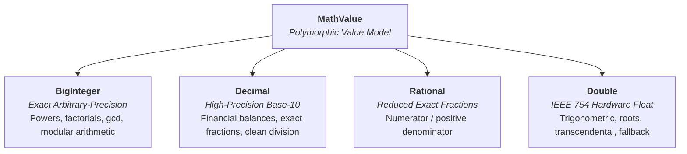
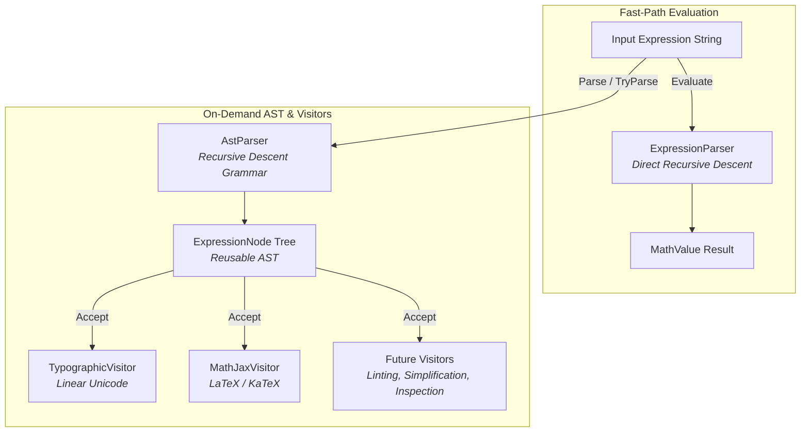

# Numerical Architecture & Type Model

Most mathematical expression evaluators rely exclusively on 64-bit IEEE 754 double-precision floating-point arithmetic (`double`). While double-precision arithmetic is fast and hardware-accelerated, it introduces noticeable limitations when evaluating everyday arithmetic:

1. **Binary Floating-Point Artifacts:** Fractions such as `0.1` and `0.3` cannot be represented with finite binary expansions. Standard engines evaluate `0.3 / 0.1` as `2.9999999999999996` rather than `3`. Financial subtraction like `3033554.11 - 3033359.71` yields `194.3999999999...` instead of `194.40`.
2. **Integer Precision Gaps:** Beyond $2^{53}$ ($\approx 9 \times 10^{15}$), consecutive integers cannot all be represented. For instance, every integer between $10^{16} - 5$ and $10^{16} + 50$ silently rounds to $10^{16}$. Larger integers like $2^{64}$ lose their least-significant bits entirely (`18446744073709600000` instead of `18446744073709551616`).

---

## The Hybrid Numerical Model

Numera stores Integer, Decimal, Rational, or Double in `MathValue`. Integer, Decimal, and Rational arithmetic preserves exact fractions within configured limits. Mixing with Double introduces an approximate boundary; exact arithmetic never silently downgrades after a limit violation.

> [!TIP]
> Representation and calculation accuracy are different: inspect `MathValue.Accuracy` (`Exact` or `Unverified`). Approximate function results remain Unverified through subsequent arithmetic, even if their resulting representation is Integer.



### 1. BigInteger (Exact Integer Arithmetic)
- Backed by .NET's arbitrary-precision `System.Numerics.BigInteger`.
- Operates within a 16,384-bit safety ceiling ($\approx 4,932$ decimal digits).
- Exact operations include integer addition, subtraction, multiplication, integer powers, bitwise shifts, `factorial(n)`, combinatorics, `gcd`, `lcm`, and number-theoretic functions.
- Integer division produces Rational unless it divides evenly (such as `10^50 / 10^49`), in which case it remains Integer.
- Perfect integer squares evaluated via `sqrt` produce exact integers (e.g. `sqrt(144) == 12`).

### 2. Decimal (Base-10 Fixed/Floating Arithmetic)
- Backed by .NET's 128-bit `System.Decimal`.
- Provides 28–29 significant digits of precision with an exact base-10 exponent.
- Preserves exact decimal fractions and financial balances without binary rounding artifacts (`3033554.11 - 3033359.71 = 194.40`, `0.3 / 0.1 == 3`).
- Finite decimal literals are parsed exactly, including scientific notation. Exact arithmetic uses numerator/denominator values internally rather than rounding to Decimal capacity.
- A decimal point selects the Decimal domain, including integral literals such as `1.00`. Scientific literals with negative exponents also select Decimal when exactly representable; scientific integers without a decimal point stay Integer.
- Integer/Decimal arithmetic retains Decimal when exactly representable, including integral answers such as `0.5 + 0.5`. Decimal capacity failures retain the exact value as Rational or Integer, rather than rounding or silently using Double. Tiny terminating fractions and long coefficients outside Decimal capacity remain exact.

### 3. Rational (Reduced Fractions)
- Stores a GCD-reduced numerator and positive denominator, bounded by `CalculationLimits`.
- `FromFraction` / `FromRational` retain Rational whenever the reduced denominator is not one, even for terminating fractions such as `1/2`. A denominator of one normalizes to Integer.
- Arithmetic involving Rational stays in that domain, with integral results normalizing to Integer. Explicit Decimal input does not convert a Rational operand to Decimal.
- Preserves results such as `1/3`, `(1/3)*3`, and `1/3 + 0.5` without expression expansion or replay.
- Integer powers, including negative powers, use bounded exact fraction arithmetic. Size failures throw `CalculationLimitException`.
- `sqrt`, `cbrt`, `root`, and `nthroot` recognize perfect fraction roots for positive integer degrees by rooting both reduced components. Domain checks use the original sign and degree, so tiny negative fractions cannot become valid even-root inputs through floating-point underflow.

### 4. Double (IEEE 754 64-Bit Floating-Point)
- Backed by hardware `System.Double`.
- Used for transcendental functions (`sin`, `cos`, `tan`, `ln`, `exp`), roots not recognized as exact, non-integer exponents, and arithmetic mixed with supplied Double values.
- Provides approximately 15–17 significant digits across magnitudes up to $\approx \pm 1.8 \times 10^{308}$.
- Overflows produce `double.PositiveInfinity` or `double.NegativeInfinity`; undefined domains return `NaN` or report structured diagnostics.
- Approximate roots retain the binary magnitude of exact inputs that would project to zero, subnormal values, or infinity before rooting. Only the final approximate root is subject to Double's output range. Standard deviation uses the same root handling but remains a Double result with Unverified accuracy, even when its variance has an exact square root.
- Negative finite bases with finite fractional power exponents report `UndefinedMathResult`. This domain check uses the original values, even when the base or exponent would overflow or underflow during Double conversion. Actual nonfinite Double exponents retain native floating-point semantics.

---

## Inspection & Conversion

`MathValue` allows callers to inspect and route results based on the exact representation chosen:

```csharp
switch (result.Kind)
{
	case MathValue.DataType.Integer:
		BigInteger intVal = result.IntegerValue;
		break;

	case MathValue.DataType.Decimal:
		decimal decVal = result.DecimalValue;
		break;

	case MathValue.DataType.Rational:
		BigInteger numerator = result.Numerator;
		BigInteger denominator = result.Denominator;
		break;

	case MathValue.DataType.Double:
		// Floating-point approximation
		double dblVal = result.DoubleValue;
		break;
}
```

Representation access and conversion are distinct. Use `ToDouble()` (or `AsDouble()`) for an explicit, potentially lossy scalar conversion and `ToDecimal()` for an explicit Decimal conversion. `TryGetExactFraction` extracts a verified-exact fraction across Integer, Decimal, and Rational representations. Supplied exact inputs assert their value, not the accuracy of any calculation performed before supplying them.

For callers who do not need storage details, `MathValue.ExactFraction` and `EvaluationResult.ExactFraction` return a nullable named tuple `(BigInteger Numerator, BigInteger Denominator)` in lowest terms. `GetExactFraction()` returns the same tuple or throws `InvalidOperationException` when finite Exact provenance is unavailable. Thus `1/3 + 2/3` exposes `(1, 1)` without requiring a Rational representation. The strict Rational-only storage getters remain unchanged. Caller-asserted Exact Doubles expose their stored binary fraction; ordinary Doubles and Unverified values do not qualify.

Representation selection is centralized after bounded fraction arithmetic; Decimal-domain operations do not use rounded native Decimal arithmetic. Exact Decimal conversion work also obeys intermediate limits. Numeric rounding helpers retain the input's exact domain, while boolean, sign, bitwise, and number-theory results use their integral result representations. Recognized perfect roots of Decimal inputs retain Decimal when exactly representable rather than becoming approximate solely because the input was stored as Decimal. Double inputs remain approximate through root evaluation, and recognized roots of Unverified inputs do not acquire Exact accuracy.

---

## Equality, Comparison, & Hashing Semantics

`MathValue` implements `IEquatable<MathValue>`, `IComparable<MathValue>`, `IComparable`, `==`, and `!=`. Comparison and equality semantics are carefully distinguished between .NET object/collection identity and expression evaluation:

- **Cross-Representation Equality**: Numerically equal values across representations compare equal (`1 == 1.0m == 1.0`, `0.5m == 0.5`).
- **Consistent Hashing**: `GetHashCode()` guarantees that any two values that compare equal produce identical hash codes across representations (including exact dyadic rationals in `Decimal` and `Double`, and signed zeros `+0.0` and `-0.0`).
- **Object Equality vs Relational NaN**:
  - `MathValue.Equals` and `operator ==` treat `NaN == NaN` as `true` to ensure reflexive semantics required by dictionary keys and hash sets.
  - In contrast, expression evaluation (`Calculator.Evaluate("NaN == NaN")` or `MathValue.AreEqual`) follows IEEE 754 relational semantics where comparisons involving `NaN` evaluate to `false`.
- **Fraction Equality**: Fractions compare without first rounding to Double. `1/3` is not equal to a nearby Decimal or Double approximation.
- **Provenance**: Numeric equality and hashing ignore `Accuracy`; metadata can be inspected separately.
- **Probable Primality**: `isprime` is deterministic through the unsigned 64-bit range. Positive results above that range are Unverified; a composite witness remains conclusive. Factorization-dependent `divcount`, `sigma`, and `totient` results above that input range are conservatively Unverified, even if a particular factorization happens to be correct.
- **Explicit Double Conversion**: Integer `DivRem` rounding implements midpoint-to-even, including direct rounding to the subnormal grid. Conversion does not retroactively certify an approximate calculation.

---

## High-Performance & Radix Formatting

`MathValue` implements modern .NET formatting interfaces and multi-radix helpers:

- **`ISpanFormattable` and `IUtf8SpanFormattable`**: Write formatted values into caller-provided character or UTF-8 buffers. Rational formatting can allocate temporary integer and text storage.
- **Multi-Radix Helpers**: For exact integers, `value.ToHexString()`, `value.ToBinaryString()`, and `value.ToOctalString()` format with (or without) standard prefixes (`0x`, `0b`, `0o`), returning `null` when the value is not an integer.
- **Launcher Presentation**: `CalculatorEngine.FormatResult(value)` produces a structured `FormattedCalculation` containing primary display text in the engine's culture, machine-readable invariant text, and integer radix strings.

The default primary display uses at most 24 significant digits with culture-aware digit grouping enabled, stripping insignificant trailing zeros. Automatic notation selection uses the rounded base-10 exponent: fixed notation applies from -24 through 23 inclusive (`MaxFixedDigits = 24`); other magnitudes transition to scientific notation. This threshold governs magnitude, not the total number of fractional digits. `ResultFormatOptions` configures this independently of arithmetic.

Digit grouping follows the culture's complete group-size sequence, including variable-sized groups and a terminal zero that stops further grouping. Finite numeric output length is checked before rendering and verified afterward. `MaxOutputCharacters` includes signs, decimal and group separators, scientific suffixes, and preserved trailing zeros; output that exactly fits the limit is permitted, and longer output is rejected rather than truncated. Fixed-layout digit counts and preserved padding are calculated once and shared by rendering and length checking.

Use the structured primary display for calculator UIs. Representation-native `ToString` and explicit .NET numeric format strings are a separate surface; Integer and Decimal formatting can retain more digits than the primary display. Exact invariant expressions may exceed a receiving engine's input-length limit even when their numeric components fit; serialization is the separate value-transfer surface.

`FractionRepresentation` is a reduced slash fraction for verified-exact finite results (`"1/3"`, `"1/2"`, or `"5"` for integers), otherwise null. `EvaluationResult.HasExactFraction` reports this capability without formatting. `IsDisplayRounded` reports formatting loss relative to the stored value, not calculation accuracy. A UI should inspect both it and `Value.Accuracy` before making an exactness claim.

Decimal literals and explicit Decimal values carry a bounded display-scale hint independently of canonical representation. Exact arithmetic and captured values retain it, including across Rational intermediates, without replaying expressions. Fixed, unrounded displays preserve scales up to four places for non-whole values and two for whole values; larger scales normalize trailing zeros. Scientific notation and the significant-digit budget take precedence. Fraction factories do not invent decimal padding merely because a fraction happens to fit Decimal. Numeric equality, hashing, and accuracy ignore the hint.

Default `EvaluationResult.ToString()`, interpolation, and character/UTF-8 span formatting use the originating engine's numeric display policy, with an explicitly supplied format provider overriding its culture. Thus `Calculator.Evaluate("194.40-100").ToString()` returns `"94.40"`. Only the numeric representation is formatted on these paths, not unused fraction/radix alternates. Explicit format strings and `MathValue` formatting retain their representation-native behavior.

Numeric providers include `CultureInfo`, `NumberFormatInfo`, and custom `IFormatProvider` implementations that supply `NumberFormatInfo`. Their separators, grouping sizes, and signs are applied without replacing the engine's precision or notation settings; their characters still count towards the output limit. A null provider retains the originating engine's culture.

For finite values, `MachineReadable` / `ToInvariantExpression()` preserve the numeric value, separately from rounded display. Decimal scale is retained where representable as an invariant decimal literal: `194.40 - 100` produces `"94.40"`, and `"94.40000"` retains five places even though its primary display trims to `"94.4"`. Machine text does not apply the significant-digit budget or primary display's trailing-zero thresholds. Double values use their exact stored binary fractions rather than decimal strings which the exact-decimal parser would interpret differently. Re-evaluation does not guarantee representation, provenance, or all display-scale metadata survives; Rational results can use reduced slash fractions without their original scale hint. Nonfinite tokens are invariant text, not re-evaluable expressions. `MathValue.Serialize()` / `Deserialize()` preserve value, representation, accuracy, and decimal display-scale metadata, including nonfinite Doubles.

### Radix Helpers

Radix helpers apply to exact integers only. Any other value returns `null`, and a negative integer keeps its sign in front of the prefix:

```csharp
var value = Calculator.Evaluate("1100");

value.ToHexString();               // "0x44C"
value.ToBinaryString();            // "0b10001001100"
value.ToOctalString();             // "0o2114"
value.ToHexString(prefix: false);  // "44C"

Calculator.Evaluate("-255").ToHexString();  // "-0xFF"
Calculator.Evaluate("1.5").ToHexString();   // null (not an integer)
```

### Span Formatting

`MathValue` supports formatting into a caller-supplied buffer:

```csharp
Span<char> buffer = stackalloc char[64];

if (value.TryFormat(buffer, out var written, default, CultureInfo.InvariantCulture))
{
	Console.WriteLine(buffer[..written]);
}
```

`TryFormat` returns `false` when the buffer is too small. `IUtf8SpanFormattable` offers the same pattern for UTF-8 output.

### Display vs. Machine-Readable Text and Culture

`FormattedCalculation` deliberately carries two text forms of the same value:

| Property | Culture | Use it for |
| :--- | :--- | :--- |
| `PrimaryDisplay` | The engine's culture | Showing the result to the user |
| `MachineReadable` | Always invariant | Clipboard, logs, storage, other programs |

```csharp
var engine = new CalculatorEngine(CalculatorOptions.ForCulture(new CultureInfo("de-DE")));

var value = engine.Evaluate("1000 + 2,5");   // the user types a decimal comma
var shown = engine.FormatResult(value);

shown.PrimaryDisplay;    // "1002,5"  (decimal comma, as the user would type it)
shown.MachineReadable;   // "1002.5"  (always invariant)
shown.HexRepresentation; // null      (not an integer)
```

The culture rules to be aware of:

- **An engine reads and writes in one culture.** `engine.FormatResult` uses the same culture the engine uses to read input, so `PrimaryDisplay` can be typed or pasted back into that engine.
- **Display text has no digit grouping.** Output is not grouped (`1002,5`, not `1.002,5`), so it stays re-parseable. Add grouping in your UI if you want it, from the original `Value`.
- **The static facade is invariant for input, but not for display.** `Calculator.Evaluate` always reads invariant text, whereas `Calculator.FormatResult(value, culture)` formats with `CultureInfo.CurrentCulture` when no culture is passed. The result may then not be re-parseable by the facade. Use an engine, or pass `CultureInfo.InvariantCulture`, when round-tripping matters.
- **Doubles use .NET's default round-trip formatting.** Unformatted `double` values use .NET's standard formatting, which produces the shortest round-trippable decimal representation. Check `Value.Type` if you need to flag a result as approximate.
- **Radix strings and `MachineReadable` never depend on culture.**

---

## Exact Cardinal Trigonometry in Degree Mode

Standard implementations of `sin(Math.PI)` in floating point produce small residual errors (e.g. `1.2246467991473532e-16`) rather than `0.0`.

When configured with `CalculatorOptions.AngleUnit = AngleUnit.Degrees` (via a `CalculatorEngine`), Numera uses .NET IEEE 754 pi-scaled trigonometric intrinsics (`SinPi`, `CosPi`). As a result:
- `sin(180)`
- `cos(90)` $\to$ `0.0` (exact)
- `sin(90)` $\to$ `1.0` (exact)
- `tan(45)` $\to$ `1.0` (exact)
- `arcsin(1)` $\to$ `90.0` (exact)

---

## On-Demand Abstract Syntax Tree (AST) & Formatting

Numera provides an on-demand AST representation alongside its zero-allocation direct evaluation path:



- **Direct Fast-Path**: `Calculator.Evaluate(expression)` evaluates directly using recursive descent without building an abstract syntax tree.
- **On-Demand AST**: `Calculator.Parse(expression)` and `Calculator.TryParse(expression, out node, out diagnostic)` construct an `ExpressionNode` hierarchy only when requested.
- **Visitor Pattern**: AST nodes implement `Accept<T>(IExpressionVisitor<T>)`, allowing arbitrary transformations, inspections, linting, and formatting.
- **Expression Formatters**: `Calculator.FormatExpression(expression, options)` renders mathematical expressions to:
  - **Normalized ASCII** - `2 * pi * sqrt(16) / 2`
  - **Typographic Unicode** - `2 × π × √(16) ÷ 2`, `2¹⁰`, `5 − 3`
  - **MathJax / LaTeX** - `\frac{2 \cdot \pi \cdot \sqrt{16}}{2}` which renders in Markdown as:
  $$
  \frac{2 \cdot \pi \cdot \sqrt{16}}{2}
  $$

Expression formatting validates `ExpressionFormatOptions` before rendering, regardless of the input's magnitude or representation. `MaxFixedDigits` must be between 1 and 1,000 and controls only the notation threshold for Integer, Decimal, and Rational nodes; scientific formatting retains the default 24-significant-digit precision. Double nodes retain their native general-format notation. Undefined rendering styles and multiplication or division symbols throw `ArgumentOutOfRangeException`.

Assignments have lower precedence than arithmetic, comparisons, and logical operators. Renderers preserve grouping around nested assignments, including function arguments, while leaving right-associative chains such as `a = b = 2` unwrapped. MathJax fraction and root structures provide their own visual grouping. Normalized ASCII output preserves assignment evaluation order and assigned values when re-evaluated; typographic and MathJax output are presentation formats, not guaranteed parser input.

---

## Evaluation Context, Variables, and Syntactic Dependencies

Numera separates point-in-time calculation state from caller-driven workflow policies:

- **Immutable `EvaluationContext`**: An evaluation context holds a snapshot of user variables, the `PreviousResult` (`ans`), and the `PreviousExpression` AST. Contexts never mutate in place; each evaluation produces a new context transition.
- **Snapshot Variables**: User variables store the evaluated `MathValue` snapshot along with metadata (`ExpressionNode? Expression` and `string? Definition`). Normal variable evaluation reads the evaluated snapshot value rather than re-executing the defining AST.
- **Syntactic Dependencies & References**:
  - `ExpressionNode.GetVariableReferences()` walks syntax trees iteratively to collect all syntactic variable reads (names and `TextSpan` source locations). It strictly excludes constants (`pi`, `e`, `tau`) and assignment targets on the left-hand side.
  - `ExpressionNode.GetReferencedVariables()` yields a case-insensitive set of referenced variable names.
  - `Variable.ReferencedVariables` returns the set of variables read by the variable's defining expression.
  - `EvaluationResult.ReferencedVariables` and `VariableReferences` expose the syntactic dependencies of the evaluated expression.
- **Caller-Controlled Replay & Reactive Recalculation**: By preserving canonical ASTs on variables and context transitions, callers (REPLs, spreadsheet engines, UI dependency graphs) can implement topological re-evaluation and history replay without Numera forcing a heavyweight runtime state machine.
