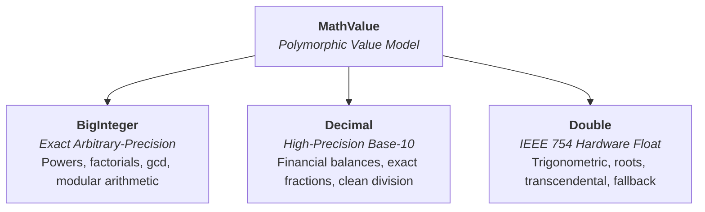
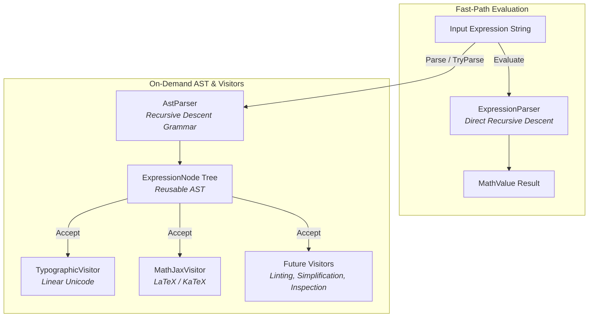

# Numerical Architecture & Type Model

Most mathematical expression evaluators rely exclusively on 64-bit IEEE 754 double-precision floating-point arithmetic (`double`). While double-precision arithmetic is fast and hardware-accelerated, it introduces noticeable limitations when evaluating everyday arithmetic:

1. **Binary Floating-Point Artifacts:** Fractions such as `0.1` and `0.3` cannot be represented with finite binary expansions. Standard engines evaluate `0.3 / 0.1` as `2.9999999999999996` rather than `3`. Financial subtraction like `3033554.11 - 3033359.71` yields `194.3999999999...` instead of `194.40`.
2. **Integer Precision Gaps:** Beyond $2^{53}$ ($\approx 9 \times 10^{15}$), consecutive integers cannot all be represented. The integers from $10^{16} - 5$ to $10^{16} + 50$ round to $10^{16}$. Larger integers like $2^{64}$ lose their least-significant bits entirely (`18446744073709600000` instead of `18446744073709551616`).

---

## The Hybrid Numerical Model

To solve this, Numera uses a tiered representation encapsulated in `MathValue`. Every operation evaluates using the most precise representation available, only degrading to approximations when mathematically required.



### 1. BigInteger (Exact Integer Arithmetic)
- Backed by .NET's arbitrary-precision `System.Numerics.BigInteger`.
- Operates within a 16,384-bit safety ceiling ($\approx 4,932$ decimal digits).
- Exact operations include integer addition, subtraction, multiplication, integer powers, bitwise shifts, `factorial(n)`, combinatorics, `gcd`, `lcm`, and number-theoretic functions.
- Integer division that divides evenly (such as `10^50 / 10^49`) preserves `BigInteger` exactness.
- Perfect integer squares evaluated via `sqrt` produce exact integers (e.g. `sqrt(144) == 12`).

### 2. Decimal (Base-10 Fixed/Floating Arithmetic)
- Backed by .NET's 128-bit `System.Decimal`.
- Provides 28–29 significant digits of precision with an exact base-10 exponent.
- Preserves exact decimal fractions and financial balances without binary rounding artifacts (`194.40`, `0.3 / 0.1 == 3`).
- If an operation overflows `decimal`'s range ($\approx \pm 7.9 \times 10^{28}$), Numera smoothly falls back to `double`.

### 3. Double (IEEE 754 64-Bit Floating-Point)
- Backed by hardware `System.Double`.
- Used for transcendental functions (`sin`, `cos`, `tan`, `ln`, `exp`), roots that are not perfect powers, non-integer exponents, and values exceeding decimal range.
- Provides approximately 15–17 significant digits across magnitudes up to $\approx \pm 1.8 \times 10^{308}$.
- Overflows produce `double.PositiveInfinity` or `double.NegativeInfinity`; undefined domains return `NaN` or report structured diagnostics.

---

## Inspection & Conversion

`MathValue` allows callers to inspect and route results based on the exact representation chosen:

```csharp
switch (result.Type)
{
	case MathValue.DataType.Integer:
		// Provably exact arbitrary-precision integer
		BigInteger intVal = result.IntVal;
		break;

	case MathValue.DataType.Decimal:
		// Exact high-precision decimal representation
		decimal decVal = result.DecVal;
		break;

	case MathValue.DataType.Double:
		// Floating-point approximation
		double dblVal = result.DblVal;
		break;
}
```

If your application only needs a standard 64-bit float, calling `result.AsDouble()` provides a convenient - if potentially lossy - conversion.

---

## High-Performance & Radix Formatting

`MathValue` implements modern .NET formatting interfaces and multi-radix helpers:

- **`ISpanFormattable` and `IUtf8SpanFormattable`**: Format directly into stack-allocated `Span<char>` or `Span<byte>` buffers without string allocations.
- **Multi-Radix Helpers**: For exact integers, `value.ToHexString()`, `value.ToBinaryString()`, and `value.ToOctalString()` format with (or without) standard prefixes (`0x`, `0b`, `0o`), returning `null` when the value is not an integer.
- **Launcher Presentation**: `Calculator.FormatResult(value, culture)` produces a structured `FormattedCalculation` containing primary display text, machine-readable invariant text, and integer radix strings.

---

## Exact Cardinal Trigonometry in Degree Mode

Standard implementations of `sin(Math.PI)` in floating point produce small residual errors (e.g. `1.2246467991473532e-16`) rather than `0.0`.

When configured with `EvaluationOptions.AngleUnit = AngleUnit.Degrees`, Numera uses .NET IEEE 754 pi-scaled trigonometric intrinsics (`SinPi`, `CosPi`). As a result:
- `sin(180)` $\to$ `0.0` (exact)
- `cos(90)` $\to$ `0.0` (exact)
- `sin(90)` $\to$ `1.0` (exact)
- `tan(45)` $\to$ `1.0` (exact)
- `arcsin(1)` $\to$ `90.0` (exact)

---

## On-Demand Abstract Syntax Tree (AST) & Formatting

Numera provides an on-demand AST representation alongside its zero-allocation direct evaluation path:



- **Direct Fast-Path**: `Calculator.Evaluate(expression)` evaluates directly using recursive descent without building an abstract syntax tree.
- **On-Demand AST**: `Calculator.Parse(expression)` and `Calculator.TryParse(expression, out node, out diagnostic)` construct an `ExpressionNode` hierarchy only when requested.
- **Visitor Pattern**: AST nodes implement `Accept<T>(IExpressionVisitor<T>)`, allowing arbitrary transformations, inspections, linting, and formatting.
- **Expression Formatters**: `Calculator.FormatExpression(expression, options)` renders mathematical expressions to:
  - **Normalized ASCII** - `2 * pi * sqrt(16) / 2`
  - **Typographic Unicode** - `2 × π × √(16) ÷ 2`, `2¹⁰`, `5 − 3`
  - **MathJax / LaTeX** - `\frac{2 \cdot \pi \cdot \sqrt{16}}{2}` which renders in Markdown as:
  $$
  \frac{2 \cdot \pi \cdot \sqrt{16}}{2}
  $$
