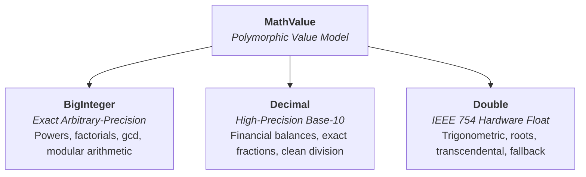
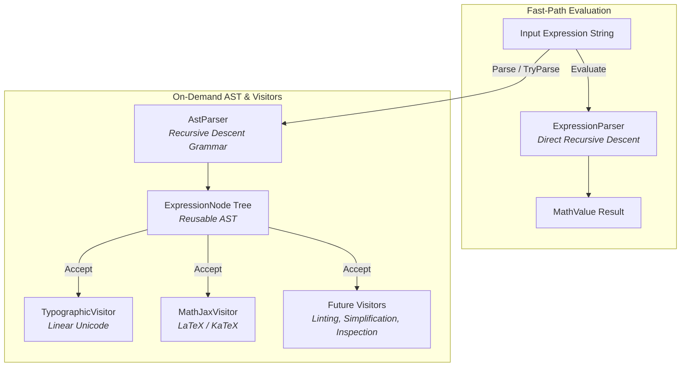

# Numerical Architecture & Type Model

Most mathematical expression evaluators rely exclusively on 64-bit IEEE 754 double-precision floating-point arithmetic (`double`). While double-precision arithmetic is fast and hardware-accelerated, it introduces noticeable limitations when evaluating everyday arithmetic:

1. **Binary Floating-Point Artifacts:** Fractions such as `0.1` and `0.3` cannot be represented with finite binary expansions. Standard engines evaluate `0.3 / 0.1` as `2.9999999999999996` rather than `3`. Financial subtraction like `3033554.11 - 3033359.71` yields `194.3999999999...` instead of `194.40`.
2. **Integer Precision Gaps:** Beyond $2^{53}$ ($\approx 9 \times 10^{15}$), consecutive integers cannot all be represented. For instance, every integer between $10^{16} - 5$ and $10^{16} + 50$ silently rounds to $10^{16}$. Larger integers like $2^{64}$ lose their least-significant bits entirely (`18446744073709600000` instead of `18446744073709551616`).

---

## The Hybrid Numerical Model

To solve this, Numera uses a tiered representation encapsulated in `MathValue`. Every operation evaluates using the most precise representation available, only degrading to approximations when mathematically required.

> [!TIP]
> In practice: whole numbers stay exact, everyday decimals stay exact, and only genuinely irrational results (such as `sin(1)`) fall back to a `double`.



### 1. BigInteger (Exact Integer Arithmetic)
- Backed by .NET's arbitrary-precision `System.Numerics.BigInteger`.
- Operates within a 16,384-bit safety ceiling ($\approx 4,932$ decimal digits).
- Exact operations include integer addition, subtraction, multiplication, integer powers, bitwise shifts, `factorial(n)`, combinatorics, `gcd`, `lcm`, and number-theoretic functions.
- Integer division that divides evenly (such as `10^50 / 10^49`) preserves `BigInteger` exactness.
- Perfect integer squares evaluated via `sqrt` produce exact integers (e.g. `sqrt(144) == 12`).

### 2. Decimal (Base-10 Fixed/Floating Arithmetic)
- Backed by .NET's 128-bit `System.Decimal`.
- Provides 28–29 significant digits of precision with an exact base-10 exponent.
- Preserves exact decimal fractions and financial balances without binary rounding artifacts (`3033554.11 - 3033359.71 = 194.40`, `0.3 / 0.1 == 3`).
- If an operation overflows `decimal`'s range ($\approx \pm 7.9 \times 10^{28}$), Numera smoothly falls back to `double`.

### 3. Double (IEEE 754 64-Bit Floating-Point)
- Backed by hardware `System.Double`.
- Used for transcendental functions (`sin`, `cos`, `tan`, `ln`, `exp`), roots that are not perfect powers, non-integer exponents, and values exceeding decimal range.
- Provides approximately 15–17 significant digits across magnitudes up to $\approx \pm 1.8 \times 10^{308}$.
- Overflows produce `double.PositiveInfinity` or `double.NegativeInfinity`; undefined domains return `NaN` or report structured diagnostics.

---

## Inspection & Conversion

`MathValue` allows callers to inspect and route results based on the exact representation chosen:

```csharp
switch (result.Type)
{
	case MathValue.DataType.Integer:
		// Provably exact arbitrary-precision integer
		BigInteger intVal = result.IntegerValue;
		break;

	case MathValue.DataType.Decimal:
		// Exact high-precision decimal representation
		decimal decVal = result.DecimalValue;
		break;

	case MathValue.DataType.Double:
		// Floating-point approximation
		double dblVal = result.DoubleValue;
		break;
}
```

If your application only needs a standard 64-bit float, calling `result.AsDouble()` provides a convenient - if potentially lossy - conversion.

---

## Equality, Comparison, & Hashing Semantics

`MathValue` implements `IEquatable<MathValue>`, `IComparable<MathValue>`, `IComparable`, `==`, and `!=`. Comparison and equality semantics are carefully distinguished between .NET object/collection identity and expression evaluation:

- **Cross-Representation Equality**: Numerically equal values across representations compare equal (`1 == 1.0m == 1.0`, `0.5m == 0.5`).
- **Consistent Hashing**: `GetHashCode()` guarantees that any two values that compare equal produce identical hash codes across representations (including exact dyadic rationals in `Decimal` and `Double`, and signed zeros `+0.0` and `-0.0`).
- **Object Equality vs Relational NaN**:
  - `MathValue.Equals` and `operator ==` treat `NaN == NaN` as `true` to ensure reflexive semantics required by dictionary keys and hash sets.
  - In contrast, expression evaluation (`Calculator.Evaluate("NaN == NaN")` or `MathValue.AreEqual`) follows IEEE 754 relational semantics where comparisons involving `NaN` evaluate to `false`.
- **Negative Integer Powers (`Pow`) and Exact Integer Division**:
  - `a^-n` is defined as `1 / a^n` using the existing division operator `/`.
  - For decimal bases with $|base| < 1$ and exact decimal inverses (such as `0.5m -> 2m`, `0.25m -> 4m`, `0.1m -> 10m`), the engine inverts the base first and computes `(1/base)^n`, turning a shrinking fractional power into an expanding whole-number power that preserves exactness in `decimal` or promotes to `BigInteger` (e.g. `0.5m^-100 == 2^100`). Exactness is checked in integer arithmetic (`ca * cb == 10^(sa + sb)`) to avoid false positives from rounded decimal products (such as `1/0.3`).
  - Integer powers of two beyond decimal's 28-digit capacity (`2^-30`, `2^-100`, `4^-15`, or whole-number decimals like `2.0m^-30`) are computed via `Math.ScaleB` directly into `double`, yielding bit-exact results down to subnormal $2^{-1074}$.
  - When exact integer division falls back to `double` (e.g. huge denominators in `1 / d` or `a / b` overflowing decimal), `DivideIntegersAsDouble` performs exact integer `DivRem` with guard bits and a sticky bit, achieving provably correct round-half-even rounding ($\le 0.5$ ULP) rather than approximate mantissa truncation.
  - For small quotients where decimal's fixed 28-digit scale would truncate significant digits, `Pow` falls back to `double` unless the decimal quotient is exact.
  - Denominators exceeding the 16,384-bit integer ceiling (e.g. `10^-5000`) fall back to `double` rather than throwing `CalculationLimitException`.

---

## High-Performance & Radix Formatting

`MathValue` implements modern .NET formatting interfaces and multi-radix helpers:

- **`ISpanFormattable` and `IUtf8SpanFormattable`**: Format directly into stack-allocated `Span<char>` or `Span<byte>` buffers without string allocations.
- **Multi-Radix Helpers**: For exact integers, `value.ToHexString()`, `value.ToBinaryString()`, and `value.ToOctalString()` format with (or without) standard prefixes (`0x`, `0b`, `0o`), returning `null` when the value is not an integer.
- **Launcher Presentation**: `CalculatorEngine.FormatResult(value)` produces a structured `FormattedCalculation` containing primary display text in the engine's culture, machine-readable invariant text, and integer radix strings.

### Radix Helpers

Radix helpers apply to exact integers only. Any other value returns `null`, and a negative integer keeps its sign in front of the prefix:

```csharp
var value = Calculator.Evaluate("1100");

value.ToHexString();               // "0x44C"
value.ToBinaryString();            // "0b10001001100"
value.ToOctalString();             // "0o2114"
value.ToHexString(prefix: false);  // "44C"

Calculator.Evaluate("-255").ToHexString();  // "-0xFF"
Calculator.Evaluate("1.5").ToHexString();   // null (not an integer)
```

### Span Formatting

`MathValue` formats into a caller-supplied buffer, so hot paths can avoid allocating a string:

```csharp
Span<char> buffer = stackalloc char[64];

if (value.TryFormat(buffer, out var written, default, CultureInfo.InvariantCulture))
{
	Console.WriteLine(buffer[..written]);
}
```

`TryFormat` returns `false` when the buffer is too small. `IUtf8SpanFormattable` offers the same pattern for UTF-8 output.

### Display vs. Machine-Readable Text and Culture

`FormattedCalculation` deliberately carries two text forms of the same value:

| Property | Culture | Use it for |
| :--- | :--- | :--- |
| `PrimaryDisplay` | The engine's culture | Showing the result to the user |
| `MachineReadable` | Always invariant | Clipboard, logs, storage, other programs |

```csharp
var engine = new CalculatorEngine(CalculatorOptions.ForCulture(new CultureInfo("de-DE")));

var value = engine.Evaluate("1000 + 2,5");   // the user types a decimal comma
var shown = engine.FormatResult(value);

shown.PrimaryDisplay;    // "1002,5"  (decimal comma, as the user would type it)
shown.MachineReadable;   // "1002.5"  (always invariant)
shown.HexRepresentation; // null      (not an integer)
```

The culture rules to be aware of:

- **An engine reads and writes in one culture.** `engine.FormatResult` uses the same culture the engine uses to read input, so `PrimaryDisplay` can be typed or pasted back into that engine.
- **Display text has no digit grouping.** Output is not grouped (`1002,5`, not `1.002,5`), so it stays re-parseable. Add grouping in your UI if you want it, from the original `Value`.
- **The static facade is invariant for input, but not for display.** `Calculator.Evaluate` always reads invariant text, whereas `Calculator.FormatResult(value, culture)` formats with `CultureInfo.CurrentCulture` when no culture is passed. The result may then not be re-parseable by the facade. Use an engine, or pass `CultureInfo.InvariantCulture`, when round-tripping matters.
- **Doubles use .NET's default round-trip formatting.** Unformatted `double` values use .NET's standard formatting, which produces the shortest round-trippable decimal representation. Check `Value.Type` if you need to flag a result as approximate.
- **Radix strings and `MachineReadable` never depend on culture.**

---

## Exact Cardinal Trigonometry in Degree Mode

Standard implementations of `sin(Math.PI)` in floating point produce small residual errors (e.g. `1.2246467991473532e-16`) rather than `0.0`.

When configured with `CalculatorOptions.AngleUnit = AngleUnit.Degrees` (via a `CalculatorEngine`), Numera uses .NET IEEE 754 pi-scaled trigonometric intrinsics (`SinPi`, `CosPi`). As a result:
- `sin(180)`
- `cos(90)` $\to$ `0.0` (exact)
- `sin(90)` $\to$ `1.0` (exact)
- `tan(45)` $\to$ `1.0` (exact)
- `arcsin(1)` $\to$ `90.0` (exact)

---

## On-Demand Abstract Syntax Tree (AST) & Formatting

Numera provides an on-demand AST representation alongside its zero-allocation direct evaluation path:



- **Direct Fast-Path**: `Calculator.Evaluate(expression)` evaluates directly using recursive descent without building an abstract syntax tree.
- **On-Demand AST**: `Calculator.Parse(expression)` and `Calculator.TryParse(expression, out node, out diagnostic)` construct an `ExpressionNode` hierarchy only when requested.
- **Visitor Pattern**: AST nodes implement `Accept<T>(IExpressionVisitor<T>)`, allowing arbitrary transformations, inspections, linting, and formatting.
- **Expression Formatters**: `Calculator.FormatExpression(expression, options)` renders mathematical expressions to:
  - **Normalized ASCII** - `2 * pi * sqrt(16) / 2`
  - **Typographic Unicode** - `2 × π × √(16) ÷ 2`, `2¹⁰`, `5 − 3`
  - **MathJax / LaTeX** - `\frac{2 \cdot \pi \cdot \sqrt{16}}{2}` which renders in Markdown as:
  $$
  \frac{2 \cdot \pi \cdot \sqrt{16}}{2}
  $$
