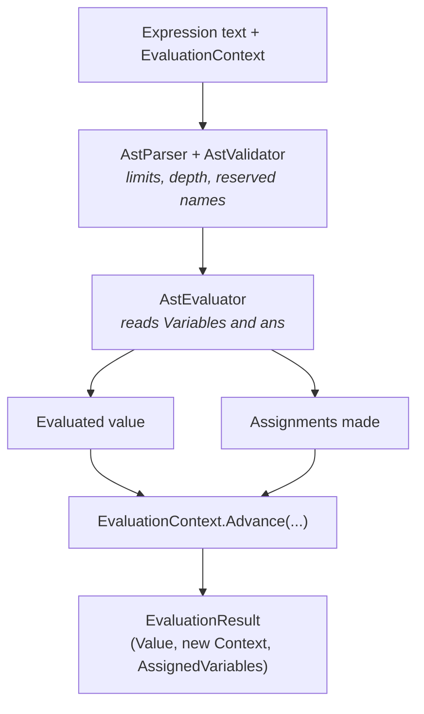

# Variables and Context

Numera can remember things between calculations: named variables, plus `ans`, the result of the previous calculation. This page explains how that state works and how to carry it from one evaluation to the next.

> [!TIP]
> If you only want to evaluate one-off expressions, you can ignore all of this. Variables only matter when you pass an `EvaluationContext` in.

---

## The big idea

The engine never stores state. Every evaluation takes a context in and hands a new one back, which makes the engine safe to share across threads and lets you branch, store or replay a session however you like.

| Type | Role |
| :--- | :--- |
| `CalculatorEngine` | Stateless, long-lived and thread-safe. Evaluates expressions. |
| `EvaluationContext` | An immutable snapshot: the session's variables plus an optional `PreviousResult` (`ans`). |
| `VariableCollection` | An immutable, ordered, case-insensitive map from name to `Variable`. Each variable includes its evaluated `MathValue`. |
| `EvaluationResult` | The value, the *new* context, and `AssignedVariables`, the added or updated variables from this evaluation only. |



---

## Assigning variables

Assignments use `=` and are right-associative, so chains work the way you would expect:

```text
x = 10
y = x * 2 + 5
x = y = 42       // y becomes 42 first, then x
```

### Naming rules

- A name starts with a letter or underscore, followed by letters, digits or underscores.
- Names are **case-insensitive** and compared ordinally, so `Rate`, `rate` and `RATE` are the same variable regardless of the machine's culture.
- A name cannot shadow anything built in:
  - constants (`pi`, `tau`, `e`, `phi`)
  - functions (`sin`, `sqrt`, `gcd`, `factorial`)
  - keywords (`and`, `or`, `xor`, `not`, `of`)

> [!WARNING]
> `e` is Euler's number, so `e = 5` is rejected. It is an easy one to trip over when you reach for short names like `a`, `b`, `c`, `d`, `e`.

Assigning to a reserved name fails with `EvaluationError.InvalidSyntax`.

### A trailing `=` is not an assignment

A trailing `=` is stripped by the [normalizer](normalization.md) as launcher decoration, so `x =` is evaluated as plain `x`. If `x` is undefined you get `UnknownConstant`, and if it is defined you get its value back, with nothing assigned.

> [!NOTE]
> This is deliberate. A user who types `x =` may well have been cut off mid-thought, but guessing at an assignment from incomplete input would be worse than reporting that `x` is unknown.

---

## `ans`: the previous result

`ans` holds the result of the previous evaluation (`EvaluationContext.PreviousResult`):

```text
Round 1:  10 + 5        => 15
Round 2:  ans * 2       => 30
Round 3:  c = ans + 5   => 35, and c is now 35
```

If you define a variable called `ans` yourself, your variable wins over `PreviousResult`.

---

## Ordering and immutability

`VariableCollection` keeps variables in the order they were last assigned:

1. A new variable is appended.
2. Reassigning an existing variable moves it to the end with its new value, so the most recently used variable is always last.
3. Names that differ only by case are one variable, and it keeps the value and spelling of the latest assignment.

The collection does not implement `IDictionary<,>`, `ICollection<>` or any other mutable interface. `Add(...)` and `SetItems(...)` return a **new** collection and leave the original untouched, so sessions can be shared across threads without locking.

> [!NOTE]
> When you build a context from a dictionary, it is copied. Changing your dictionary afterwards never affects an evaluation that is already running.

---

## Multi-round example

Pass the `Context` from each result into the next call:

```csharp
var engine = new CalculatorEngine();
var context = EvaluationContext.Empty;

// Round 1: define 'a'
var r1 = engine.Evaluate("a = 10", context);
context = r1.Context;

// Round 2: use 'a' to define 'b'
var r2 = engine.Evaluate("b = a * 2 + 5", context);
context = r2.Context;

// Round 3: use 'ans' and 'a'
var r3 = engine.Evaluate("c = ans + a", context);
context = r3.Context;

Console.WriteLine($"Result: {r3.Value}");                                  // 35
Console.WriteLine($"Total variables: {context.Variables.Count}");         // 3 (a, b, c)
Console.WriteLine($"Delta in round 3: {r3.AssignedVariables.Single().Name}"); // c
```

---

## Safety and limits

Variables get no special treatment: they sit behind the same limits as everything else (see [Safety Limits](safety-and-limits.md)).

| Limit | What it means for variables |
| :--- | :--- |
| `MaxInputLength` | The whole expression, assignments included, is capped (default 4,096 characters). |
| `MaxNestingDepth` | Chained assignments count towards nesting depth, and are checked while parsing as well as during validation. |
| `MaxIntegerBits` | A value stored in a variable, or supplied through a context, cannot exceed 16,384 bits. Oversized `MathValue`s are rejected at construction. |

> [!IMPORTANT]
> Parsing and validation only *read* the context. Nothing is mutated until an evaluation succeeds and `Advance` produces a new context, so a failed evaluation can never leave a half-updated session behind.
