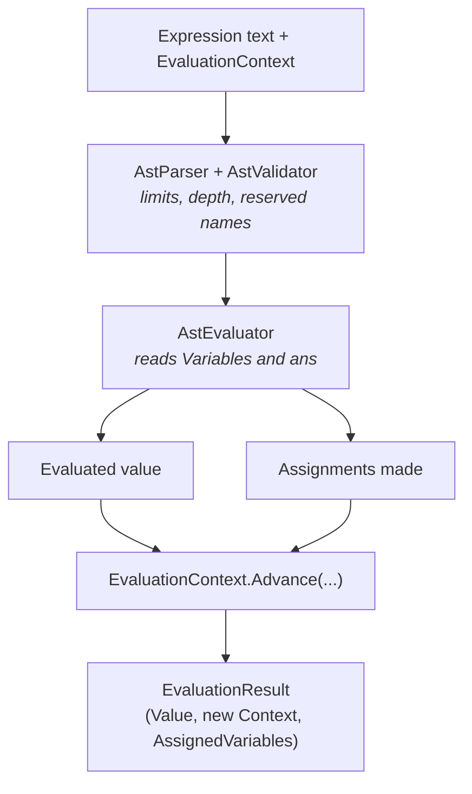

# Variables and Context

Numera can remember things between calculations: named variables, plus `ans`, the result of the previous calculation. This page explains how that state works and how to carry it from one evaluation to the next.

> [!TIP]
> If you only want to evaluate one-off expressions, you can ignore all of this. Variables only matter when you pass an `EvaluationContext` in.

---

## The big idea

The engine never stores state. Every evaluation takes a context in and hands a new one back, which makes the engine safe to share across threads and lets you branch, store or replay a session however you like.

| Type | Role |
| :--- | :--- |
| `CalculatorEngine` | Stateless, long-lived and thread-safe. Evaluates expressions. |
| `EvaluationContext` | An immutable snapshot: the session's variables plus an optional `PreviousResult` (`ans`). |
| `VariableCollection` | An immutable, ordered, case-insensitive map from name to `Variable`. Each variable includes its evaluated `MathValue`. |
| `EvaluationResult` | The value, the *new* context, and `AssignedVariables`, the added or updated variables from this evaluation only. |



---

## Assigning variables

Assignments use `=` and are right-associative, so chains work the way you would expect:

```text
x = 10
y = x * 2 + 5
x = y = 42       // y becomes 42 first, then x
```

An assignment returns the value it stores, so you can also use it inside a
larger calculation. `(x = 5) + 1` gives `6`, with `x` holding `5`.
Later operands can use an earlier assignment: `1 + (y = 2) * y` gives `5`,
because the assignment runs before the following `y` is read.

These variables appear in the returned context just like top-level assignments;
parentheses do not make them temporary. An assignment in a skipped logical branch
does not run: `0 and (x = 5)` gives `0` without assigning `x`. See
[logical operators](syntax.md#logical-and-bitwise-operations) for short-circuiting.

### Naming rules

- A name starts with a letter or underscore, followed by letters, ASCII digits or underscores.
  Mathematical constant symbols cannot appear inside a variable name.
- Names are **case-insensitive** and compared ordinally, so `Rate`, `rate` and `RATE` are the same variable regardless of the machine's culture.
- A name cannot shadow anything built in:
  - constants (`pi`, `tau`, `e`, `phi`, `true`, `false`, and their aliases)
  - functions (`sin`, `sqrt`, `gcd`, `factorial`, and their aliases)
  - keywords (`and`, `or`, `xor`, `not`, `of`)
  - the previous-result name (`ans`)

> [!WARNING]
> `e` is Euler's number, so `e = 5` is rejected. It is an easy one to trip over when you reach for short names like `a`, `b`, `c`, `d`, `e`.

Assigning to a reserved name fails with `EvaluationError.InvalidSyntax`.

When your app supplies variables directly, `new Variable(...)` checks the name's
syntax, and `EvaluationContext` checks for reserved names. For example, `"foo bar"`
and `"2x"` are invalid identifiers, while `"pi"` and `"sin"` are reserved. These
checks throw `ArgumentException`; a null name throws `ArgumentNullException`.

An engine's registered custom functions also reserve their names. If it registers
`tw`, a supplied context cannot contain a variable named `tw` or `TW`, even when
the expression does not use that name.

This is an invalid context argument, not an expression error. Parsing, evaluation,
and expression formatting throw `ArgumentException` with parameter name `context`;
`TryParse` and `TryEvaluate` throw it too. Rename the variable or function before
using that context with the engine.

### Incomplete assignments and launcher decoration

`x =` is an incomplete assignment, not a request to evaluate `x`. It reports
`EvaluationError.InvalidSyntax` at the `=`, with `IsIncomplete = true` when the
input ends before the value. A closed group such as `(x = )` is malformed instead.
Parsing failures do not execute callbacks or commit assignments. See
[typing-aware diagnostics](safety-and-limits.md#while-the-user-is-typing) for UI handling.

With launcher trimming enabled, completed expressions and assignments can have
trailing equals decoration:

- `2 + 2 =` evaluates to `4`.
- `x = 5 =` assigns `5` to `x`; the stored definition is `5`, without decoration.
- `a = b = 5 =` assigns `5` to both variables.

The [normalizer](normalization.md) removes decoration, not assignment operators or
syntax errors. Disable decoration with `TrimLauncherEquals = false`, or use raw
input with `Normalization = null`.

---

## `ans`: the previous result

`ans` holds the result of the previous evaluation (`EvaluationContext.PreviousResult`):

```text
Round 1:  10 + 5        => 15
Round 2:  ans * 2       => 30
Round 3:  c = ans + 5   => 35, and c is now 35
```

`ans` is reserved, case-insensitively: `ans = 5` is rejected with
`InvalidSyntax`. Context variables cannot use that name either: supplying one
through a constructor, initializer, or `with` expression throws `ArgumentException`.

To seed or replace the previous answer explicitly, use `PreviousResult`:

```csharp
var context = EvaluationContext.Empty with { PreviousResult = new MathValue(5) };
```

Evaluating `5` normally also advances the previous answer to `5`. A null
`PreviousResult` leaves `ans` undefined; using it reports `NoPreviousResult`,
not an incomplete expression. Other undefined variable names report `UnknownVariable`.

---

## Ordering and immutability

`VariableCollection` keeps variables in the order they were last assigned:

1. A new variable is appended.
2. Reassigning an existing variable moves it to the end with its new value, so the most recently used variable is always last.
3. Names that differ only by case are one variable, and it keeps the value and spelling of the latest assignment.

The collection does not implement `IDictionary<,>`, `ICollection<>` or any other mutable interface. `Add(...)` and `SetItems(...)` return a **new** collection and leave the original untouched, so sessions can be shared across threads without locking.

> [!NOTE]
> When you build a context from a dictionary, it is copied. Changing your dictionary afterwards never affects an evaluation that is already running.

---

## Multi-round example

Pass the `Context` from each result into the next call:

```csharp
var engine = new CalculatorEngine();
var context = EvaluationContext.Empty;

// Round 1: define 'a'
var r1 = engine.Evaluate("a = 10", context);
context = r1.Context;

// Round 2: use 'a' to define 'b'
var r2 = engine.Evaluate("b = a * 2 + 5", context);
context = r2.Context;

// Round 3: use 'ans' and 'a'
var r3 = engine.Evaluate("c = ans + a", context);
context = r3.Context;

Console.WriteLine($"Result: {r3.Value}");                                  // 35
Console.WriteLine($"Total variables: {context.Variables.Count}");         // 3 (a, b, c)
Console.WriteLine($"Delta in round 3: {r3.AssignedVariables.Single().Name}"); // c
```

---

## Combining completed results

You can also do arithmetic on results you already have:

```csharp
var engine = new CalculatorEngine();
var subtotal = engine.Evaluate("200");
var increase = engine.Evaluate("10%");
var total = subtotal + increase; // 220, using calculator percentage rules

var next = engine.Evaluate("ans / 2", total.Context); // 110
```

Here, `total.Context` gives you the combined answer as `ans`, along with the
variables from both results. The arithmetic uses values already calculated, so
assignments, random calls, and custom functions do not run again. No new
assignments are recorded.

For the results to share a context, any variable found on both sides must match.
Names are compared case-insensitively. The stored values must have the same
representation, exactness, and display scale; Decimal and Double values are
compared bit-for-bit. Definition text must match exactly, and expressions must be
structurally equal, ignoring source positions.

A matching variable keeps its spelling, metadata, and collection position from
the left result. Variables found only on the right are appended in their existing
order.

The calculator options must be equal when both results supply them, including
display settings. If you create separate options with custom functions, reuse
the same function collection: matching names and signatures alone do not mean
that functions have the same implementation. A manually constructed result
without options uses the other result's options, or library defaults if neither
supplies them.

A conflicting variable or option causes `InvalidOperationException` before any
arithmetic, with the name or setting identified in the message. A
default-initialized `EvaluationResult` has no usable context and cannot take part
in arithmetic.

The stored expression helps you display and inspect the calculation's history,
but it is not necessarily a formula you can replay in the combined context.
For example, the two original expressions may refer to different earlier values
of `ans`. The arithmetic uses each result's calculated value; `ans` in the
combined context holds the new answer.

If you only need numeric arithmetic, use `subtotal.Value + increase.Value`.
The answer is `200.1`: a `MathValue` stores the number, not the percentage notation
that makes the result-level addition an increase. Arithmetic between a result
and a plain value keeps the result's context and settings.

---

## Safety and limits

Variables get no special treatment: they sit behind the same limits as everything else (see [Safety Limits](safety-and-limits.md)).

| Limit | What it means for variables |
| :--- | :--- |
| `MaxInputLength` | The whole expression, assignments included, is capped (default 4,096 characters). |
| `MaxNestingDepth` | Chained assignments count towards nesting depth, and are checked while parsing as well as during validation. |
| `MaxIntegerBits` | A value stored in a variable, or supplied through a context, cannot exceed 16,384 bits. Oversized `MathValue`s are rejected at construction. |

> [!IMPORTANT]
> Parsing and validation only *read* the context. Nothing is mutated until an evaluation succeeds and `Advance` produces a new context, so a failed evaluation can never leave a half-updated session behind.
